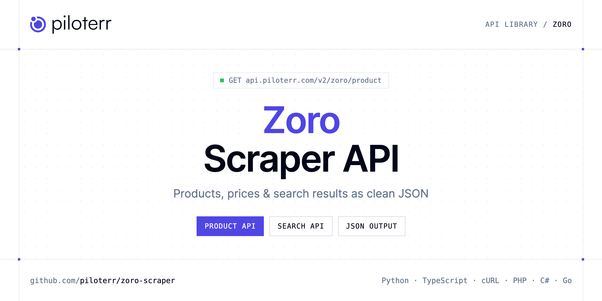

<p align="center">
  <a href="https://www.piloterr.com"></a>
</p>

# Zoro Scraper API

[](https://discord.gg/CFj3ph8aHU) [](https://app.piloterr.com) [](https://app.piloterr.com/openapi) [](LICENSE)

The **Piloterr Zoro Scraper API** lets you extract public data from Zoro as **clean, structured JSON** — no proxies, headless browsers or HTML parsing to maintain. Endpoints available in production:

- **Zoro Product API** — Get a Zoro product page: title, brand, USD price, Zoro number, manufacturer number, images, and specifications.
- **Zoro Search API** — Search Zoro by keyword or category URL.

Use it for price monitoring, assortment tracking, competitor analysis, product research or catalog enrichment.

| Endpoint | Path | Credits | What you get |
|---|---|---|---|
| [Zoro Product API](#zoro-product-api) | `/v2/zoro/product` | 2 | Get a Zoro product page |
| [Zoro Search API](#zoro-search-api) | `/v2/zoro/search` | 2 | Search Zoro by keyword or category URL. Returns product cards with USD price, brand, Zoro number, and pagination. |

## Table of contents

- [How it works](#how-it-works)
- [Zoro Product API](#zoro-product-api)
- [Zoro Search API](#zoro-search-api)
- [Code examples in other languages](#code-examples-in-other-languages)
- [Practical use cases](#practical-use-cases)
- [Why Piloterr?](#why-piloterr)
- [FAQ](#faq)
- [Related scrapers](#related-scrapers)
- [Support](#support)

## How it works

1. **Create a free Piloterr account** and copy your API key from the [dashboard](https://app.piloterr.com).
2. **Send a `GET` (or `POST`) request** to `https://api.piloterr.com/v2/...` with the header `x-api-key: YOUR_API_KEY`.
3. **Receive structured JSON** — Piloterr handles rendering, proxies, retries and parsing.

```bash
export PILOTERR_API_KEY="your-api-key"
pip install requests        # Python
# TypeScript: Node.js 18+ (native fetch), run with `npx tsx file.ts`
```

> Every endpoint accepts both `GET` (query string) and `POST` (JSON body with the same fields).

## Zoro Product API

Get a Zoro product page: title, brand, USD price, Zoro number, manufacturer number, images, and specifications.

`GET | POST https://api.piloterr.com/v2/zoro/product` · **2 credits per request** · [Full reference](https://app.piloterr.com/openapi)

### Request parameters

| Parameter | Type | Required | Description |
|---|---|---|---|
| `query` | string | ✅ | Zoro product URL, or a path that contains `/i/G...`. |
| `return_page_source` | boolean | — | When true, return the rendered HTML as `{"result": "..."}` instead of JSON. |

### Python example

```python
import json
import os
import requests

response = requests.get(
    "https://api.piloterr.com/v2/zoro/product",
    headers={"x-api-key": os.environ["PILOTERR_API_KEY"]},
    params={
        "query": "https://www.zoro.com/3m-safety-glasses-securefit-200-series-scotchgard-anti-fog-frameless-blue-temples-clear-lens-sf201sgaf-blu/i/G1937045/",
    },
    timeout=120,
)
response.raise_for_status()
data = response.json()

print(json.dumps(data, indent=2, ensure_ascii=False)[:2000])
```

### TypeScript example

```typescript
type ZoroProduct = {
  url?: string;
  gtin?: string;
  brand?: string;
  image?: string;
  price?: number;
  title?: string;
  images?: string[];
  mfr_no?: string;
  zoro_no?: string;
  currency?: string;
  in_stock?: boolean;
  price_unit?: string;
  breadcrumbs?: {
    url?: string;
    name?: string;
  }[];
  description?: string;
  price_display?: string;
  specifications?: {
    Item?: string;
    "MFR #"?: string;
    "UPC #"?: string;
    Gender?: string;
    Series?: string;
    "Zoro #"?: string;
    Features?: string;
    "Used For"?: string;
    "Arm Color"?: string;
    Standards?: string;
    "Foam Lined"?: string;
    "Frame Type"?: string;
    "Hinge Type"?: string;
    "Lens Color"?: string;
    Application?: string;
    "Frame Color"?: string;
    "Frame Style"?: string;
    "Arm Material"?: string;
    "Arm Tip Type"?: string;
    "Eyewear Size"?: string;
    "Lens Coating"?: string;
    "Lens Material"?: string;
    "UV Protection"?: string;
    "Frame Material"?: string;
    "Metal Detectable"?: string;
    [key: string]: unknown;
  };
};

const params = new URLSearchParams({
  "query": "https://www.zoro.com/3m-safety-glasses-securefit-200-series-scotchgard-anti-fog-frameless-blue-temples-clear-lens-sf201sgaf-blu/i/G1937045/",
});

const response = await fetch(`https://api.piloterr.com/v2/zoro/product?${params}`, {
  headers: { "x-api-key": process.env.PILOTERR_API_KEY! },
});
if (!response.ok) throw new Error(`Piloterr error ${response.status}: ${await response.text()}`);

const data = (await response.json()) as ZoroProduct;

console.log(JSON.stringify(data, null, 2).slice(0, 2000));
```

<details>
<summary><b>POST variant</b></summary>

```http
POST https://api.piloterr.com/v2/zoro/product
x-api-key: YOUR_API_KEY
Content-Type: application/json

{"query": "https://www.zoro.com/3m-safety-glasses-securefit-200-series-scotchgard-anti-fog-frameless-blue-temples-clear-lens-sf201sgaf-blu/i/G1937045/"}
```
</details>

### Output example

Example response from the API reference, abridged — real values depend on the page you scrape.

```json
{
  "url": "https://www.zoro.com/3m-safety-glasses-securefit-200-series-scotchgard-anti-fog-frameless-blue-temples-clear-lens-sf201sgaf-blu/i/G1937045/",
  "gtin": "076308944872",
  "brand": "3M",
  "image": "https://www.zoro.com/static/cms/product/large/490a8043-20d5-41d6-9c12-44adaae21e83.jpeg",
  "price": 8.99,
  "title": "Safety Glasses, SecureFit 200 Series, Scotchgard Anti-Fog, Frameless, Blue Temples, Clear Lens",
  "images": [
    "https://www.zoro.com/static/cms/product/large/490a8043-20d5-41d6-9c12-44adaae21e83.jpeg",
    "https://www.zoro.com/static/cms/product/large/Grainger_493X64xx2xx5a17d9.jpeg"
  ],
  "mfr_no": "SF201SGAF-BLU",
  "zoro_no": "G1937045",
  "currency": "USD",
  "in_stock": true,
  "price_unit": "ea",
  "breadcrumbs": [
    {
      "url": "https://www.zoro.com/safety/c/z1/",
      "name": "Safety"
    },
    {
      "url": "https://www.zoro.com/personal-protective-equipment-ppe/c/13/",
      "name": "Personal Protective Equipment (PPE)"
    }
  ],
  "description": "Safety Glasses, Series SecureFit(TM) 200, Gender Unisex, Lens Color Clear, Polarized Lens No, Lens Coating Scotchgard(TM) Anti-Fog, No Fo…",
  "price_display": "$8.99",
  "specifications": {
    "Item": "Safety Glasses",
    "MFR #": "SF201SGAF-BLU",
    "UPC #": "076308944872",
    "Gender": "Unisex",
    "Series": "SecureFit 200",
    "Zoro #": "G1937045",
    "Features": "3M™ Pressure Diffusion Temple Technology; Impact-resistant Lens",
    "Used For": "Assembly, Construction, Food & Beverage Manufacturing, General Manufacturing, Repair & Operation (MO)",
    "Arm Color": "Blue",
    "Standards": "ANSI-ISEA Z87.1-2020, CSA Z94.3",
    "Foam Lined": "No",
    "Frame Type": "Frameless",
    "Hinge Type": "Barrel",
    "Lens Color": "Clear",
    "Application": "General Purpose",
    "Frame Color": "Blue",
    "Frame Style": "Wraparound",
    "Arm Material": "Xylex",
    "Arm Tip Type": "Wraparound",
    "Eyewear Size": "Universal",
    "Lens Coating": "Scotchgard Anti-Fog & Anti-Scratch",
    "Lens Material": "Polycarbonate",
    "UV Protection": "99.99% UVA/UVB",
    "Frame Material": "Polycarbonate",
    "Metal Detectable": "No"
  }
}
```

### Response fields

| Field | Type | Description |
|---|---|---|
| `url` | string |  |
| `gtin` | string |  |
| `brand` | string |  |
| `image` | string |  |
| `price` | number |  |
| `title` | string |  |
| `images` | string[] |  |
| `mfr_no` | string |  |
| `zoro_no` | string |  |
| `currency` | string |  |
| `in_stock` | boolean |  |
| `price_unit` | string |  |
| `breadcrumbs[]` | object[] |  |
| `breadcrumbs[].url` | string |  |
| `breadcrumbs[].name` | string |  |
| `description` | string |  |
| `price_display` | string |  |
| `specifications` | object |  |
| `specifications.Item` | string |  |
| `specifications.MFR #` | string |  |
| `specifications.UPC #` | string |  |
| `specifications.Gender` | string |  |
| `specifications.Series` | string |  |
| `specifications.Zoro #` | string |  |
| `specifications.Features` | string |  |

## Zoro Search API

Search Zoro by keyword or category URL. Returns product cards with USD price, brand, Zoro number, and pagination.

`GET | POST https://api.piloterr.com/v2/zoro/search` · **2 credits per request** · [Full reference](https://app.piloterr.com/openapi)

### Request parameters

| Parameter | Type | Required | Description |
|---|---|---|---|
| `query` | string | ✅ | Keyword, or a Zoro search or category URL. Empty, another host, or a product URL returns 400. A keyword builds /search?q=.... Each card has price as a USD number and price_display as the dollar string. |
| `page` | number | — | Page number starting at 1. Omit it for page 1. Page 2 adds page=2, sets pagination.page to 2, and returns the next cards. pagination.next is the next page URL, or null on the last page. A value below 1 returns 400. |
| `return_page_source` | boolean | — | Default false. true replaces results and pagination with result, the rendered HTML. |

### Python example

```python
import json
import os
import requests

response = requests.get(
    "https://api.piloterr.com/v2/zoro/search",
    headers={"x-api-key": os.environ["PILOTERR_API_KEY"]},
    params={
        "query": "safety glasses",
    },
    timeout=120,
)
response.raise_for_status()
data = response.json()

print(json.dumps(data, indent=2, ensure_ascii=False)[:2000])
```

### TypeScript example

```typescript
type ZoroSearch = {
  results?: {
    url?: string;
    brand?: string;
    image?: string;
    price?: number;
    title?: string;
    mfr_no?: string;
    rating?: number;
    zoro_no?: string;
    currency?: string;
    price_unit?: string;
    review_count?: number;
    package_price?: number;
    price_display?: string;
    package_quantity?: number;
    package_price_display?: string;
  }[];
  pagination?: {
    next?: string;
    page?: number;
    per_page?: number;
    total_pages?: unknown;
    total_results?: number;
  };
};

const params = new URLSearchParams({
  "query": "safety glasses",
});

const response = await fetch(`https://api.piloterr.com/v2/zoro/search?${params}`, {
  headers: { "x-api-key": process.env.PILOTERR_API_KEY! },
});
if (!response.ok) throw new Error(`Piloterr error ${response.status}: ${await response.text()}`);

const data = (await response.json()) as ZoroSearch;

console.log(JSON.stringify(data, null, 2).slice(0, 2000));
```

<details>
<summary><b>POST variant</b></summary>

```http
POST https://api.piloterr.com/v2/zoro/search
x-api-key: YOUR_API_KEY
Content-Type: application/json

{"query": "safety glasses"}
```
</details>

### Output example

Example response from the API reference, abridged — real values depend on the page you scrape.

```json
{
  "results": [
    {
      "url": "https://www.zoro.com/mcr-safety-bearkat-bk1-safety-glasses-duramass-hard-coat-clear-lens-non-slip-temple-frameless-bk110/i/G2426514/",
      "brand": "Mcr Safety",
      "image": "https://www.zoro.com/static/cms/product/full/7e6737c8-0823-4e5f-9c53-2002b0476883.jpeg",
      "price": 1.39,
      "title": "BearKat (BK1), Safety Glasses, Duramass Hard Coat, Clear Lens, Non-Slip Temple, Frameless",
      "mfr_no": "BK110",
      "rating": 4.86,
      "zoro_no": "G2426514",
      "currency": "USD",
      "price_unit": "ea",
      "review_count": 49,
      "package_price": 16.68,
      "price_display": "$1.39",
      "package_quantity": 12,
      "package_price_display": "$16.68"
    }
  ],
  "pagination": {
    "next": "https://www.zoro.com/safety-glasses/c/6214/?q=safety+glasses&page=2",
    "page": 1,
    "per_page": 36,
    "total_pages": null,
    "total_results": 3000
  }
}
```

### Response fields

| Field | Type | Description |
|---|---|---|
| `results[]` | object[] |  |
| `results[].url` | string |  |
| `results[].brand` | string |  |
| `results[].image` | string |  |
| `results[].price` | number |  |
| `results[].title` | string |  |
| `results[].mfr_no` | string |  |
| `results[].rating` | number |  |
| `results[].zoro_no` | string |  |
| `results[].currency` | string |  |
| `results[].price_unit` | string |  |
| `results[].review_count` | integer |  |
| `results[].package_price` | number |  |
| `results[].price_display` | string |  |
| `results[].package_quantity` | integer |  |
| `results[].package_price_display` | string |  |
| `pagination` | object |  |
| `pagination.next` | string |  |
| `pagination.page` | integer |  |
| `pagination.per_page` | integer |  |
| `pagination.total_pages` | object |  |
| `pagination.total_results` | integer |  |

## Code examples in other languages

Ready-to-run examples live in the [`examples/`](examples) folder. Each one reads your key from the `PILOTERR_API_KEY` environment variable.

| Language | Product | Search |
|---|---|---|
| cURL (Bash) | [`product`](examples/curl/product.sh) | [`search`](examples/curl/search.sh) |
| PHP | [`product`](examples/php/product.php) | [`search`](examples/php/search.php) |
| C# | [`product`](examples/csharp/Product.cs) | [`search`](examples/csharp/Search.cs) |
| Go | [`product`](examples/go/product.go) | [`search`](examples/go/search.go) |
| Java | [`product`](examples/java/ProductExample.java) | [`search`](examples/java/SearchExample.java) |
| Ruby | [`product`](examples/ruby/product.rb) | [`search`](examples/ruby/search.rb) |
| Node.js | [`product`](examples/nodejs/product.mjs) | [`search`](examples/nodejs/search.mjs) |

## Practical use cases

- **Price monitoring** — Track prices, promotions and availability over time to react to competitors.
- **Assortment & catalog tracking** — Follow new products, delisted items and category changes.
- **Competitor analysis** — Benchmark ranges, brands and positioning across retailers.
- **Product research** — Spot best-sellers and trends from search results.
- **Catalog enrichment** — Pull titles, images and attributes into your PIM or marketplace listings.

## Why Piloterr?

- **No infrastructure** — no proxies, headless browsers or CAPTCHA solving to run yourself.
- **Structured JSON** — stable, documented fields instead of brittle HTML selectors.
- **Pay per request** — transparent credit cost per endpoint, failed requests are retried for you.
- **One API key, hundreds of sources** — Zoro plus many other e-commerce, search and company data endpoints in the [Piloterr library](https://www.piloterr.com/library).
- **Any language** — plain HTTPS + JSON, with examples for Python, TypeScript, cURL, PHP, C#, Go, Java, Ruby and Node.js.

## FAQ

### Is it legal to scrape Zoro?

Collecting publicly available data is generally allowed in many jurisdictions, but rules depend on your country, the data you collect and how you use it. Avoid personal data unless you have a lawful basis, respect the website's terms where they apply, and get legal advice for your specific use case. This is not legal advice.

### Do I need proxies or a headless browser?

No. Piloterr handles rendering, proxy rotation and retries on its side. You only send an HTTPS request with your `x-api-key` header and receive JSON.

### How much does a request cost?

Credits per call: `/v2/zoro/product` **2**, `/v2/zoro/search` **2**. See the [Piloterr website](https://www.piloterr.com) for plans.

### What data does the Zoro API return?

Each endpoint returns structured JSON: **Zoro Product** — `url`, `gtin`, `brand`, `image`, `price`, `title`; **Zoro Search** — `results[]`, `results[].url`, `results[].brand`, `results[].image`, `results[].price`, `results[].title`.

### How do I paginate Zoro results?

Use the `page` parameter and keep requesting while the response indicates more results.

### Can I get the raw HTML instead of JSON?

Yes. Set `return_page_source=true` and the response becomes `{"result": "..."}` with the page source.

### Which languages are supported?

Any language that can make an HTTP request. This README shows Python and TypeScript; the [`examples/`](examples) folder contains cURL, PHP, C#, Go, Java, Ruby and Node.js.

## Related scrapers

- [About You Scraper API](https://github.com/piloterr/aboutyou-scraper)
- [Action Scraper API](https://github.com/piloterr/action-scraper)
- [Aldi Scraper API](https://github.com/piloterr/aldi-scraper)
- [Alibaba Scraper API](https://github.com/piloterr/alibaba-scraper)
- [AliExpress Scraper API](https://github.com/piloterr/aliexpress-scraper)
- [Allegro Scraper API](https://github.com/piloterr/allegro-scraper)
- [All Piloterr scrapers on GitHub](https://github.com/piloterr)

## Support

- 💬 Join the [Piloterr Discord](https://discord.gg/CFj3ph8aHU) to ask questions and share what you build.
- 📚 Browse the [API reference (OpenAPI)](https://app.piloterr.com/openapi) and the [Piloterr library](https://www.piloterr.com/library).
- 🔑 [Get your API key](https://app.piloterr.com).

---

<p align="center">
  <a href="https://www.piloterr.com">
    <picture>
      <source media="(prefers-color-scheme: dark)" srcset="images/logo-dark.svg">
      
    </picture>
  </a>
  <br>
  <sub>Built by <a href="https://www.piloterr.com">Piloterr</a> — web scraping APIs for e-commerce, search, real estate and more, one API key.</sub>
</p>

<sub>Zoro is a trademark of its respective owner. This repository is not affiliated with or endorsed by Zoro. Examples are released under the MIT license.</sub>
